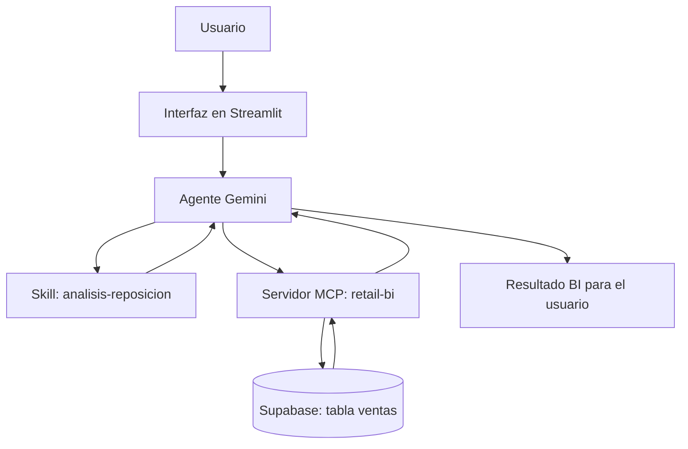

# Arquitectura del Sistema de Business Intelligence (BI)

Este documento describe la estructura y el funcionamiento del sistema agéntico para el análisis de ventas, clasificación ABC y detección de productos clave en riesgo para una tienda en línea basada en el conjunto de datos **Online Retail II**.

## 1. Diagrama de la Arquitectura



## 2. Componentes del Sistema

| Componente | ¿Qué hace? | Tecnología | Archivo principal |
| :---- | :---- | :---- | :---- |
| **Interfaz de Usuario** | Muestra el chat interactivo para hacer preguntas y ver resultados visuales. | Streamlit | frontend/app.py |
| **Agente Inteligente** | Recibe la pregunta, decide qué herramientas usar y genera la respuesta final. | Gemini API (Google) | agents/agente.py |
| **Habilidad (Skill)** | Guía paso a paso para analizar reposición de inventario y calidad de productos. | Markdown / Prompting | skills/analisis-reposicion/SKILL.md |
| **Servidor MCP** | Expone las 4 herramientas de consulta a la base de datos siguiendo el protocolo MCP. | Python SDK (FastMCP) | backend/mcp_server.py |
| **Base de Datos** | Almacena los registros reales de ventas transaccionales. | PostgreSQL en Supabase | Tabla ventas |

*Librería de GitHub adaptada:* [modelcontextprotocol/python-sdk](https://github.com/modelcontextprotocol/python-sdk) utilizando FastMCP.

## 3. Flujo Paso a Paso de una Consulta

1. **Entrada:** El usuario escribe una duda en la interfaz de Streamlit (por ejemplo: *"¿Qué productos importantes están cayendo?"*).
2. **Procesamiento:** frontend/app.py llama a la función `responder(pregunta)` de agents/agente.py.
3. **Invocación de herramientas:** El agente (Gemini) analiza la consulta e invoca una o varias herramientas del servidor MCP retail-bi.
4. **Consulta a datos:** El servidor MCP se conecta a **Supabase** y ejecuta la consulta sobre la tabla ventas.
5. **Retorno de datos:** Supabase responde al servidor MCP, y este entrega los datos exactos al agente.
6. **Respuesta final:** El agente construye la respuesta en español citando los números y devuelve el objeto según el contrato:

```json
{
  "respuesta": "Texto de la respuesta final...",
  "herramientas_usadas": [
    {
      "nombre": "productos_en_riesgo",
      "argumentos": {"umbral_caida": 0.30, "limite": 10},
      "resultado": "..."
    }
  ]
}
```

## 4. Gestión de Errores y Excepciones

| Situación de error | Control y solución |
| :---- | :---- |
| **Base de datos caída o sin conexión** | El servidor MCP captura el error de conexión y devuelve `{"error": ...}`. El agente informa al usuario de que no hay acceso a los datos en este momento. |
| **Error en la herramienta** | Si una consulta falla o recibe argumentos inválidos, el agente reintenta una vez con parámetros corregidos. Si persiste, notifica el fallo sin detener la app. |
| **Pregunta fuera de tema** | Si el usuario pregunta algo ajeno al negocio (ej. *"¿Qué tiempo hace hoy?"*), el agente responde indicando que solo analiza datos de ventas. |
| **Intento de alucinación (inventar números)** | Por instrucción estricta, el agente **solo** menciona cifras devueltas por el servidor MCP. Si no hay datos, indica: *"No tengo datos para responder a esa pregunta"*. |

## 5. Control y Autorización Humana

* **Solo lectura:** el agente es exclusivamente analítico y consultivo.
* **Sin acciones directas:** el sistema nunca crea órdenes de compra, no modifica stock en la base de datos ni altera precios.
* **Decisión humana:** todas las recomendaciones (revisar proveedores, lanzar promociones o ajustar reposición) deben ser evaluadas y autorizadas por un gestor de inventario.
